# Freedom Planet 2 Tails Mod

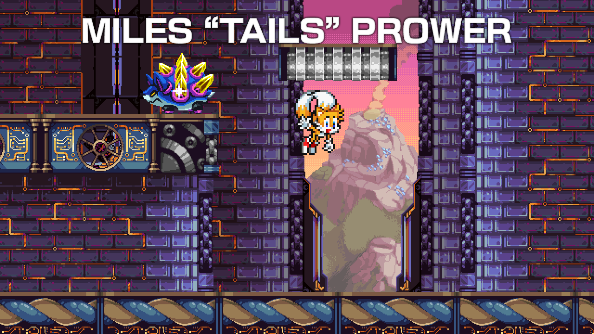

A mod for Freedom Planet 2 (using [FP2Lib](https://github.com/Kuborros/FP2Lib)) that adds Miles "Tails" Prower as a playable character.

## Features

### Moveset

#### Spin Jump

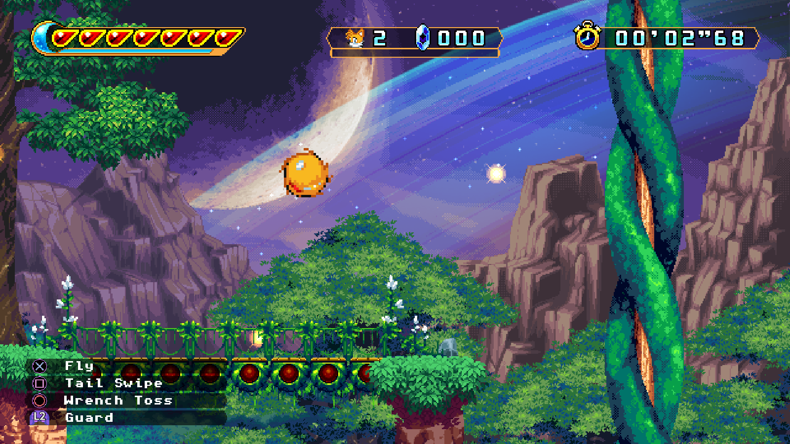

A replacement for the default jump, causing Tails to curl into a ball that can cause weak, but consistent damage to enemies.

#### Roll

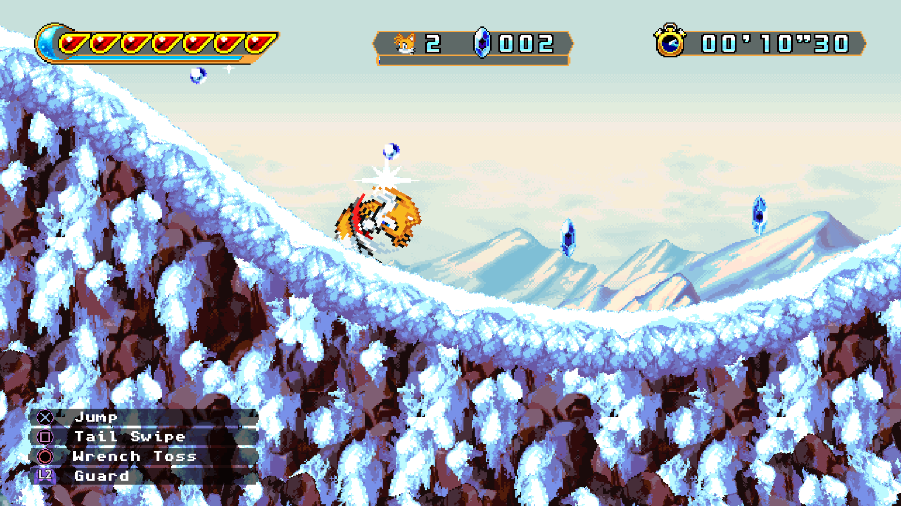

Hold down while running to roll.

#### Spin Dash

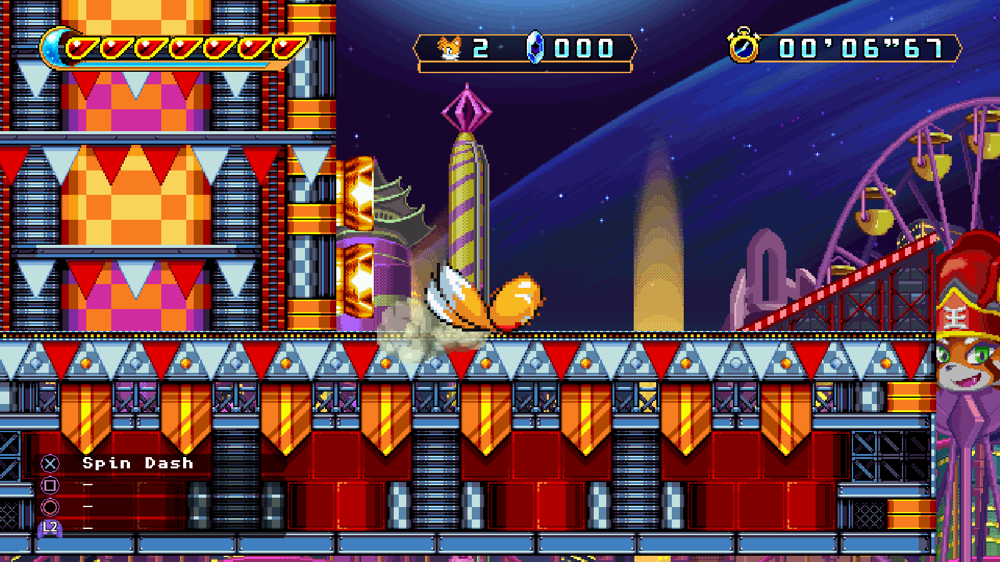

While on the ground, hold down and press the jump button to begin charging a Spin Dash. Repeatedly tap the button to increase the power of the Spin Dash, then release down to blast off at high speed.

#### Flight

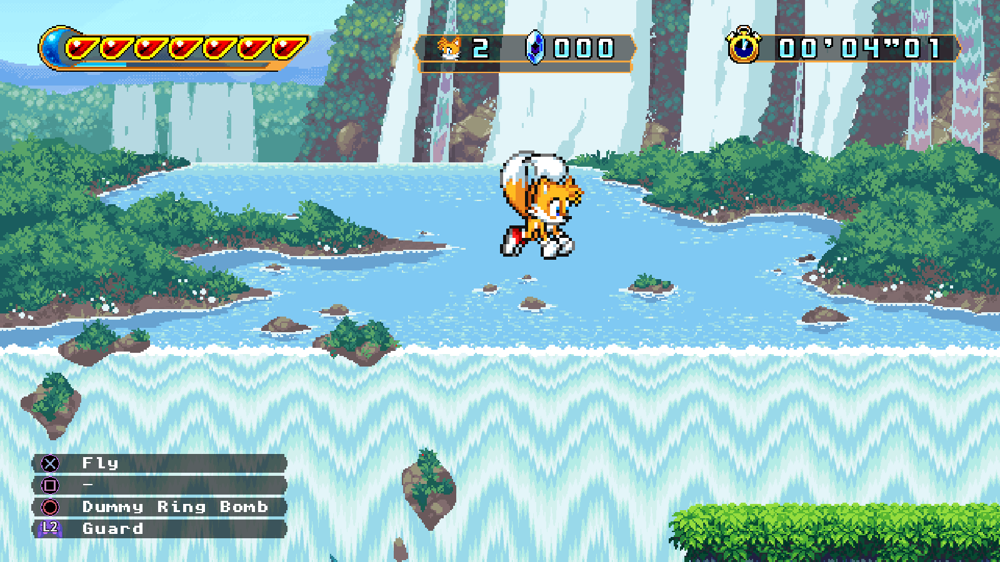

While airborne, press the jump button to begin flying. Tap the jump button to gain height. Flying consumes energy, and Tails will tire out and fall when the energy gague is depleted.

#### Tail Swipe

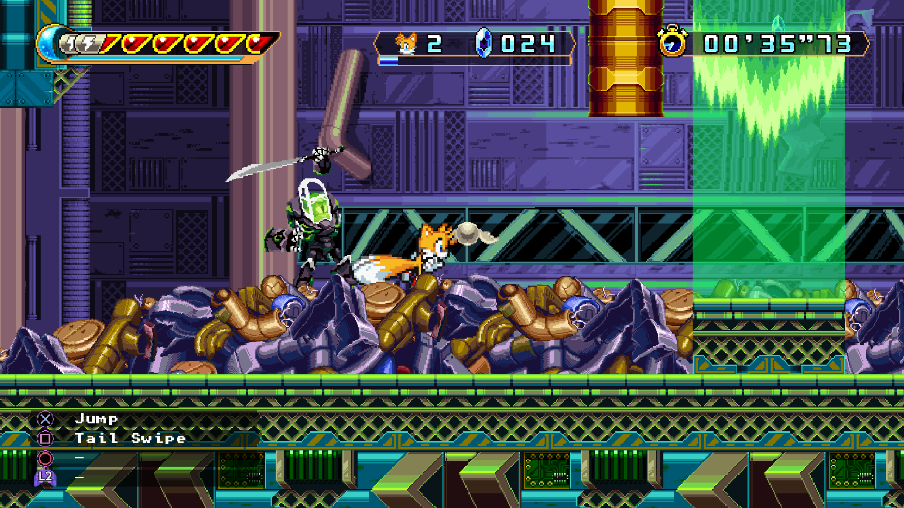

Press the attack button to perform a Tail Swipe, having Tails twirl around to use his tails as a weapon. Hold the attack button to chain the attack.

#### Tail Dunk

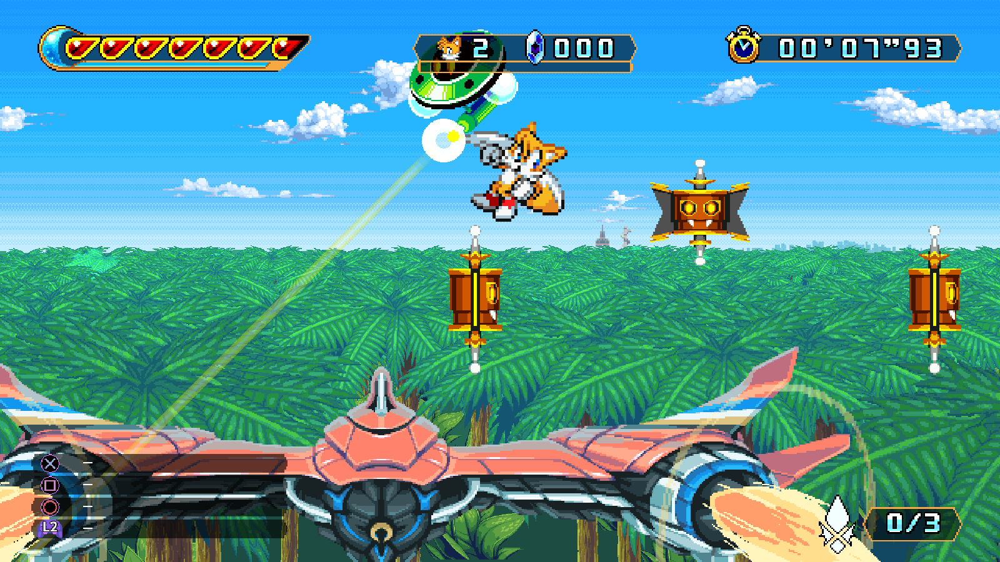

While airborne, hold down and press the attack button to perform a downwards Tail Dunk attack.

#### Back Rotor

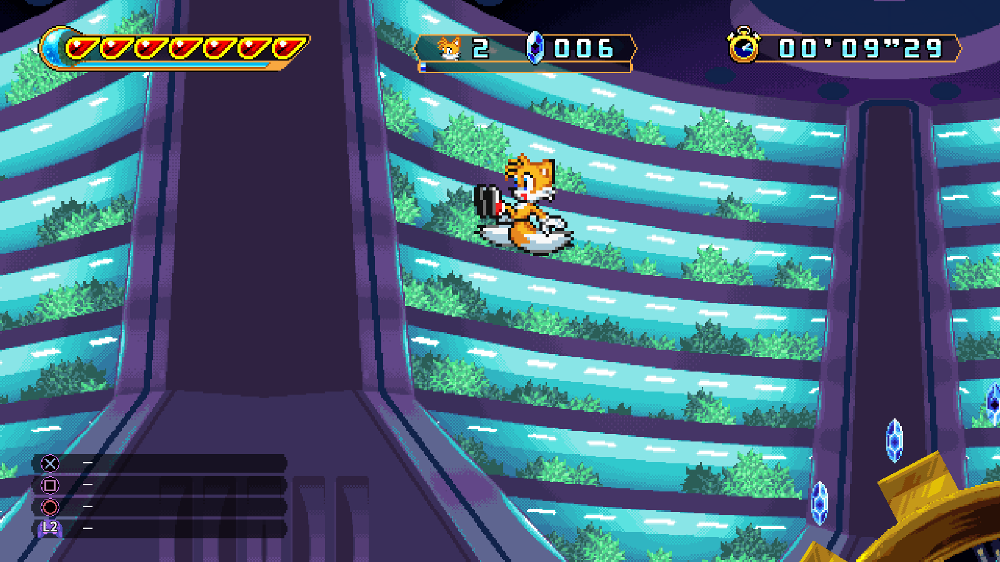

Hold up and press the attack button to perform a Back Rotor, Tails will jump in the opposite direction to the one he's going in then begin flying afterwards.

#### Wrench Toss

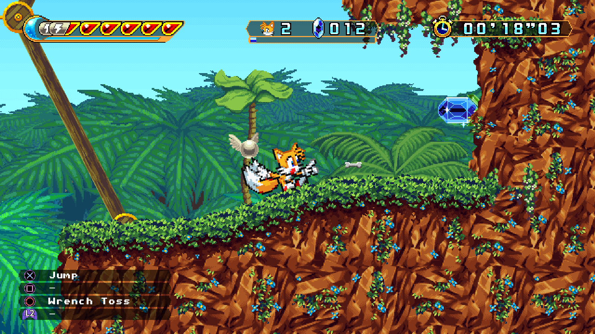

Press the special button to throw a Wrench. Hold up or down to angle the throw's arc.

#### Dummy Ring Bomb

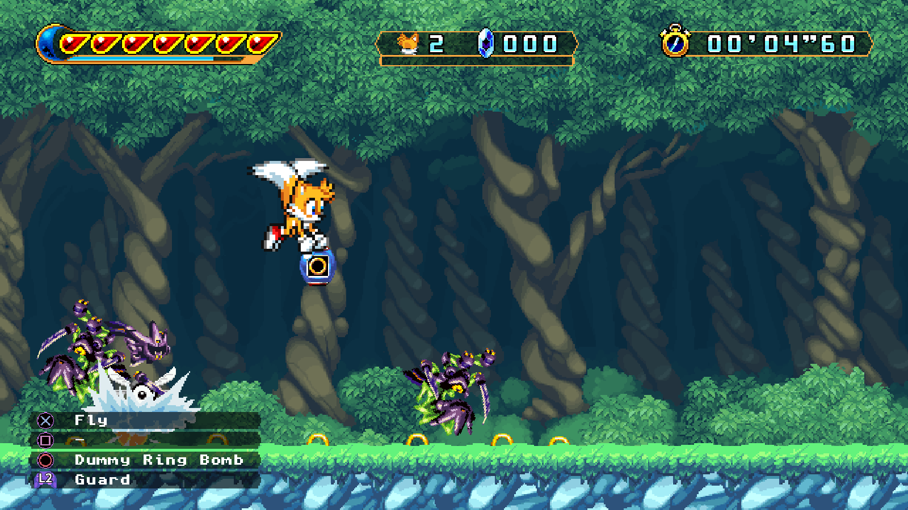

While flying, press the special button to drop a Dummy Ring Bomb. Upon colliding with an enemy or surface, the bomb will explode and scatter weak, but plentiful Dummy Ring projectiles around.

### Items

#### Jet Anklet

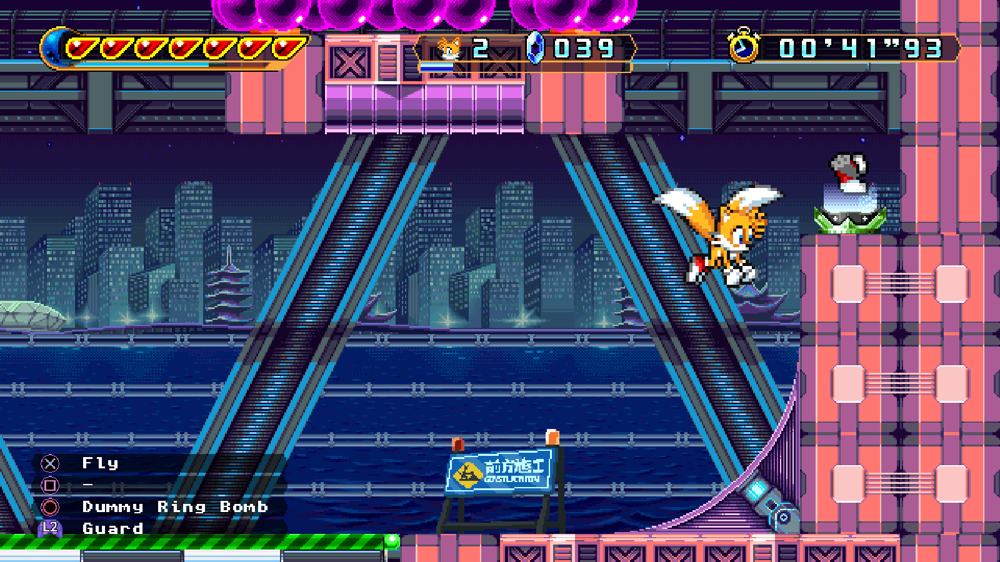

Tails' personal power up item, granting massively increased flight speed for roughly 15 seconds.

### Achievements

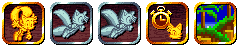

Tails adds five new achievements. These achievements are:

- Fly High: Clear the game as Tails.
- Westside Speedster: Beat any stage's par time as Tails.
- 92 Miles Per Hour: Beat any stage as Tails in less than half of the par time.
- Twin Tail Turbo: Beat the par times in all stages as Tails.
- Home Sweet Home: Unlock and complete Emerald Hill Zone.

### Vinyls

Tails adds eight new Vinyls for purchase in the Vinyl Shop, these tracks being:

- Jet Anklet: The jingle used when Tails' Jet Anklet item is active, taken from Sonic Adventure.
- Stage Clear - Tails: The jingle used when clearing a stage as Tails, taken from Sonic Adventure 2.
- Results - Tails: The theme used during the results screen for Tails, taken from Sonic Adventure 2.
- Believe in Myself (Tails' Theme): The theme used during the credits for Tails, taken from Sonic Adventure 2.
- Super Tails: The theme used when transforming into Super Tails (using the Chaos Emeralds item from the [Sonic mod](https://github.com/Knuxfan24/Freedom-Planet-2-Sonic-Mod/)), taken from Sonic and All-Stars Racing Transformed.
- Map - Emerald Hill: The theme used when highlighting Emerald Hill Zone on the map, taken from Sonic The Hedgehog 2.
- Emerald Hill Zone: The theme used in Sonic's tutorial and Green Hill Zone, taken from Sonic The Hedgehog 2.
- Stage Clear - Emerald Hill: The jingle used when clearing Green Hill Zone, taken from Sonic The Hedgehog 2.

## Building

First off, ensure that your system has a modern version of [Visual Studio](https://visualstudio.microsoft.com/) installed alongside the `.NET Framework 3.5 development tools`, as well as [Unity 5.6.3](https://unity.com/releases/editor/whats-new/5.6.3#installs) and [FP2Lib](https://github.com/Kuborros/FP2Lib) (at least Version 0.6.1. The [Freedom Manager](https://github.com/Kuborros/FreedomManager) program should install this automatically if used.).

Open the solution file in Visual Studio then go to `Tools > Options` and select `Package Sources` under the `NuGet Package Manager` category. Then add a package source called `BepInEx` with the source url set to `https://nuget.bepinex.dev/v3/index.json`.

Next, go to the `Assemblies` category in the `Dependencies` for the project, then delete the `Assembly-CSharp` and `FP2Lib` references. Right click on the Assemblies category and click `Add Assembly Reference...`, then click `Browse...` and navigate to Freedom Planet 2's install directory. Open the `FP2_Data` directory, then the `Managed` directory and select the `Assembly-CSharp.dll` file. Click Add, then Browse again and navigate to the location that FP2Lib's DLL is installed to (likely `BepInEx\Plugins\lib`) and select the `FP2Lib.dll` file. Click Add, then click OK.

You should now be able to right click the solution and choose `Rebuild` to build the mod.

## Installing

Navigate to `BepInEx/plugins` and create a new folder with whatever name you want. Then copy the `Freedom_Planet_2_Tails_Mod.dll` file from the build (`bin/Debug/net35` or `bin/Release/net35`) into it. If using Freedom Manager, you may also want to copy the included `modinfo.json` file to give the mod a proper entry in the manager, although this is not strictly required.

In addition, copy the `tails.assets` and `tails.scene` files from the resources folder of this repo into `mod_overrides` folder in Freedom Planet 2's root (create that directory if its not present).

## Asset Credits

Tails Sprites - Sonic Advance 1, 2, 3 and Battle, ripped by [AsuharaMoon](https://www.spriters-resource.com/game_boy_advance/sonicadv/asset/28301/), [Ice](https://www.spriters-resource.com/game_boy_advance/sonicadv2/asset/154244/), [Ren](https://www.spriters-resource.com/game_boy_advance/sonicadv3/asset/7146/) and [QuadFactor](https://www.spriters-resource.com/game_boy_advance/sonicbattle/asset/10040/).

Custom Bakunawa Chase Tornado 2 Sprites - Created by [Silverbolt](https://www.spriters-resource.com/custom_edited/sonicthehedgehogcustoms/asset/18272/).

Character Select Portrait - Sonic Advance 3, ripped by [HXC](https://www.spriters-resource.com/game_boy_advance/sonicadv3/sheet/7151/).

File Icon - Sonic Jump, ripped by [Xyroneriz](https://www.spriters-resource.com/mobile/sonicjumpjava/asset/192392/).

Life Icon - Sonic Advance, ripped by [EternalLight](https://www.spriters-resource.com/game_boy_advance/sonicadv/sheet/6600/).

Tutorial Omochao - Sonic Advance 3, ripped by [Gussprint](https://www.spriters-resource.com/game_boy_advance/sonicadv3/asset/27437/).